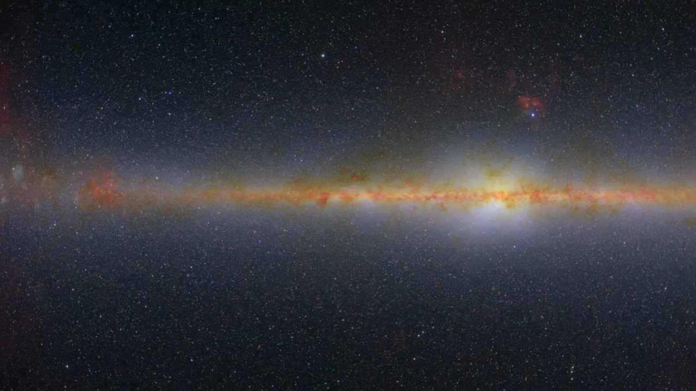

<h1 align="center">SpectraX</h1>

<p align="center">
  Compare real SPHEREx observations across time and explore the sky in 102 infrared bands.
</p>

<p align="center">
  <a href="https://github.com/Pentexa/SpectraX/actions/workflows/backend.yml"></a>
  <a href="frontend/package.json"></a>
  <a href="pyproject.toml"></a>
  <a href="https://science.nasa.gov/mission/spherex/"></a>
</p>

<p align="center">
  <a href="https://www.jpl.nasa.gov/images/pia26600-spherexs-first-all-sky-map/">
    
  </a>
  <br>
  <sub>SPHEREx first all-sky panorama · NASA/JPL-Caltech</sub>
</p>

Built for **Planet X and SPHEREx**, a [2026 NASA Space Apps Challenge](https://www.spaceappschallenge.org/2026/). Read the [development journey](DEVELOPMENT_JOURNEY.md).

## Explore

| View | What you can do |
| --- | --- |
| `/atlas` | Choose a target or enter sky coordinates. Start with the Aladin Lite DSS2 atlas and add Gaia DR3 or AllWISE overlays. |
| Observation comparison | Browse DR1 and QR3 visits, blink between aligned images, build a timeline, or subtract, sum and stack compatible exposures. Inspect FITS quality flags and provenance. |
| `/spectral` | Open the DR1 spectrum and band image at a sky position. Select among 102 channels or combine the 17 channels from a detector. Toggle individual pixels to inspect the cutout. |
| `/research` | Open the five challenge targets and reproduce the [benchmark results](docs/benchmarks/CHALLENGE_TARGETS.md). |
| `/embed` | Use the atlas coordinate panel to copy a share link or an iframe with your field and selected observations. |

## Run locally

Install **Python 3.11** and **Node.js 24**, then clone the repository.

```sh
git clone https://github.com/Pentexa/SpectraX.git
cd SpectraX
```

Start the API from the repository root.

**PowerShell**

```powershell
python -m venv .venv
.\.venv\Scripts\python.exe -m pip install -e '.[test]'
.\.venv\Scripts\planet-x-api.exe
```

**macOS / Linux**

```sh
python3.11 -m venv .venv
.venv/bin/python -m pip install -e '.[test]'
.venv/bin/planet-x-api
```

In another terminal at the repository root, start the web app.

```sh
npm ci --prefix frontend
npm run dev --prefix frontend
```

Open the [web app](http://localhost:3000) or the [interactive API docs](http://127.0.0.1:8765/docs). Next.js proxies browser requests from `/science/api/*` to the FastAPI service at `http://127.0.0.1:8765`. For a different backend URL, copy [the frontend environment example](frontend/.env.local.example) to `frontend/.env.local` and set `SPECTRAX_API_URL` before starting or building Next.js. See [backend environment settings](.env.example).

### Prepare local FITS files

The web app requests official archive data first. For offline tests and backup coverage of the example fields, activate the virtual environment and run `planet-x-data --include-benchmarks --include-cubes` from the repository root. Downloads are checked against the manifest. The example cube is about 321 MB.

## Data and methods

- **NASA/IPAC IRSA** provides the SPHEREx DR1 and QR3 calibrated FITS images and the DR1 All-Sky Cube. Comparisons use FITS WCS and masks. Spectra show sky-pixel surface brightness in the multi-epoch mosaic. [Full data inventory and dataset DOIs](docs/DATA_SOURCES.md)
- **Gaia DR3 and AllWISE** provide catalog overlays through CDS VizieR. **SIMBAD** provides the target astrometry references. **AAVSO** observations supply optical reference light curves for RW Aurigae and R Draconis.
- **DSS2** provides the Aladin Lite atlas background via the MAST and NASA/IPAC IRSA mirrors. The app shows archive or local delivery when it has that information.

## Repository

```text
frontend/       Next.js web application and media
apps/api/       FastAPI routes
pipeline/       Archive downloads, FITS processing and measurements
data/manifests/ Versioned archive products and checksums
tests/          Backend and archive integration tests
deploy/         Backend container and gateway configuration
docs/           API reference, data inventory and benchmark results
```

With the virtual environment activated, run checks from the repository root.

```sh
python -m pytest -q -ra
npm run lint --prefix frontend
npm run build --prefix frontend
```

GitHub Actions runs the frontend checks and backend tests. On `main`, the backend workflow also verifies real FITS products and publishes the API container to GitHub Container Registry. See the [API reference](docs/API.md) for endpoints, real-data smoke tests, and container setup.

## Credits

**Project team:** Ahmet Aras Akyasan, Mustafa Emir Yayla, Korhan Erol, and Nisanur Cakir.

**AI assistance:** GPT SOL 6.1 supported coding. GLM 5.3 supported code review.
